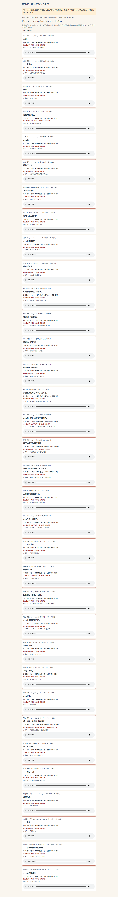
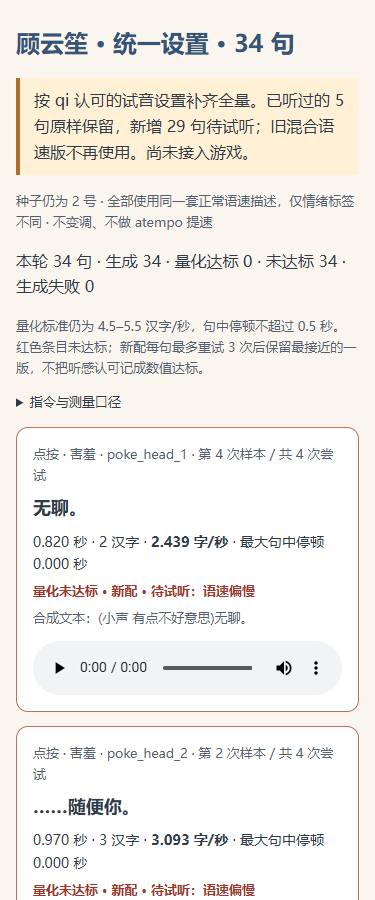

# 云笙统一设置全量配音完成（34 句，本地已提交）

## 做了什么
- 按 qi 认可的 5 句试音设置（「很棒就按这个」）补齐其余 29 句：同一条共享描述、情绪只用 assistant 前缀标签（平淡/有点恼/小声 有点不好意思/轻松）、无场景描述、不变速拉伸。
- 已认可的 5 句（poke_face_2、chat_06、chat_07、chat_10、feed_coffee_2）原样保留，sha256 与试音目录逐一比对一致。
- 新增 29 句共 116 次生成（每句最多 4 次），0 次 API 失败；每句按「未达标优先选停顿小、语速接近 5 字/秒」挑一条。
- 重做全量试听页（34 行，标注「试听已认可·原样保留」/「新配·待试听」）和 yunsheng_lines.json 清单；生成完成后已自动打开完整试听页。
- 未接入游戏：js/app.js、data/lines_yunsheng.js、data/scenes_yunsheng.js、种子音频均未改动。

## 提交号
- main 本地提交：`690967c63d54a2eff70e2d2c1f3e897fa0af8d14`（37 个文件：34 条 mp3 + results.json + 试听页 + 清单）。
- 按规矩未推送 main；音频不推收件箱，本地路径和时长见下表。

## 测试结果
- 量化门槛（4.5–5.5 字/秒、句中停顿 ≤0.5 秒）：34 句全部未达标（语速均低于 4.5 字/秒），如实记为 out_of_range，没有用变速硬凑。
- 独立复核：ffmpeg silencedetect（-50dB、d=0.5）在 34 条入选音频里未发现 ≥0.5 秒静音；feed_coffee_3 用 RMS 法测得 0.530 秒停顿，两种方法差异如实记录。
- 试听页浏览器验收（headless Edge）：HTTP 与 file:// 两种打开方式各 34/34 播放到结束；原生控件暂停/续播、独占播放、错误恢复正常；375/768/1200 三档视口无横向溢出；控制台 0 错误、0 失败请求（修掉了一个 favicon 404）。
- 截图：
  - 桌面整页：
  - 手机首屏：

## 没做成的
- 量化语速门槛一句都没过：MiMo 这套设置输出整体偏慢（1.08–4.49 字/秒）。按约定如实记录，听感认可与量化分开标注。
- feed_coffee_3 在 RMS 口径下有 0.530 秒句中停顿（略超 0.5 秒门槛）。
- 批处理脚本有一个未触发的边界：输出目录在首次报告写入前被中断会挡住续跑校验；本次未发生，暂未修。

## 需要 qi 决定的
1. 试听 29 句新配（页面已自动打开）：`C:\Users\jiaai\.zcode\workspace\draft-f0907a4f-f57d-40b5-af1e-9820c8acefd9\yuejian\assets\voice\yunsheng\listen.html`
2. 全部句子量化未达标、但听感沿用你认可的设置——照单全收，还是再调？
3. 接入游戏（阶段 B）与推送 main 都等你明确发话。

## 音频本地路径与每条时长
目录：`C:\Users\jiaai\.zcode\workspace\draft-f0907a4f-f57d-40b5-af1e-9820c8acefd9\yuejian\assets\voice\yunsheng\unified\`（文件名 = 下表 id + `.mp3`）

时长为剪边后（首尾各留 ≤0.15 秒）；字/秒只数汉字；停顿为 RMS 法最大句中停顿。

| id | 台词 | 时长(秒) | 字/秒 | 最大停顿(秒) | 选中次 | 状态 |
| --- | --- | --- | --- | --- | --- | --- |
| poke_head_1 | 无聊。 | 0.820 | 2.44 | 0.000 | 4 | 新配·待听 |
| poke_head_2 | ……随便你。 | 0.970 | 3.09 | 0.000 | 2 | 新配·待听 |
| poke_face_1 | 别戳。 | 0.960 | 2.08 | 0.020 | 4 | 新配·待听 |
| poke_face_2 | 再戳我就关门了。 | 1.730 | 4.05 | 0.020 | 2 | 已认可·保留 |
| poke_hand_1 | ……痒。 | 0.930 | 1.08 | 0.020 | 2 | 新配·待听 |
| poke_hand_2 | 戳够了就走。 | 1.520 | 3.29 | 0.000 | 1 | 新配·待听 |
| poke_shoulder_l_1 | 下次记得敲门。 | 1.690 | 3.55 | 0.010 | 3 | 新配·待听 |
| poke_shoulder_l_2 | 你每天都这么闲？ | 1.870 | 3.74 | 0.040 | 1 | 新配·待听 |
| poke_shoulder_r_1 | ……你手很闲？ | 1.450 | 2.76 | 0.000 | 4 | 新配·待听 |
| poke_shoulder_r_2 | 我在看报告。 | 1.220 | 4.10 | 0.010 | 2 | 新配·待听 |
| chat_01 | 今天的报告写了六千字。 | 2.980 | 3.36 | 0.160 | 2 | 新配·待听 |
| chat_02 | 楼道那只猫又来了。 | 2.850 | 2.81 | 0.020 | 3 | 新配·待听 |
| chat_03 | 黑咖啡，不加糖。 | 1.930 | 3.11 | 0.380 | 4 | 新配·待听 |
| chat_04 | 夜澜的棋下得还行。 | 2.100 | 3.81 | 0.000 | 2 | 新配·待听 |
| chat_05 | 实验室的灯坏了两天，没人修。 | 3.110 | 3.86 | 0.240 | 3 | 新配·待听 |
| chat_06 | ……你居然还记得我不吃甜的。 | 2.580 | 4.26 | 0.070 | 1 | 已认可·保留 |
| chat_07 | 明天半夜可能要去现场。 | 2.850 | 3.51 | 0.010 | 1 | 已认可·保留 |
| chat_08 | 推理小说看到一半，凶手太蠢了。 | 3.790 | 3.43 | 0.400 | 4 | 新配·待听 |
| chat_09 | 无聊的问题就别问了。 | 2.240 | 4.02 | 0.010 | 1 | 新配·待听 |
| chat_10 | ……今天，谢谢你。 | 2.260 | 2.21 | 0.090 | 2 | 已认可·保留 |
| feed_coffee_1 | ……放那儿吧。 | 0.930 | 4.30 | 0.010 | 3 | 新配·待听 |
| feed_coffee_2 | 还算合口味。 | 1.300 | 3.85 | 0.000 | 4 | 已认可·保留 |
| feed_catcan_1 | 给我这个干什么。无聊。 | 3.450 | 2.61 | 0.260 | 2 | 新配·待听 |
| feed_catcan_2 | ……楼道那只猫会吃。 | 2.210 | 3.17 | 0.060 | 4 | 新配·待听 |
| feed_sweets_1 | 我不吃甜的。 | 1.270 | 3.94 | 0.010 | 2 | 新配·待听 |
| feed_sweets_2 | 拿走。无聊。 | 2.030 | 1.97 | 0.380 | 4 | 新配·待听 |
| feed_bread_1 | ……谢谢。 | 0.830 | 2.41 | 0.010 | 3 | 新配·待听 |
| feed_coffee_3 | 第二杯了。你是想让我通宵？ | 3.160 | 3.48 | 0.530 | 4 | 新配·待听 |
| feed_sweets_3 | 说了不吃甜的。 | 1.740 | 3.45 | 0.030 | 1 | 新配·待听 |
| feed_catcan_3 | ……就这一次。 | 1.160 | 3.45 | 0.000 | 4 | 新配·待听 |
| scene_coffee_open | 放那儿吧。 | 0.890 | 4.49 | 0.000 | 2 | 新配·待听 |
| scene_coffee_choice_a | ……多事。 | 0.940 | 2.13 | 0.000 | 4 | 新配·待听 |
| scene_coffee_choice_b | ……明天还有明天的报告。 | 2.310 | 3.90 | 0.020 | 2 | 新配·待听 |
| scene_coffee_end | ……还算合口味。 | 1.540 | 3.25 | 0.000 | 2 | 新配·待听 |